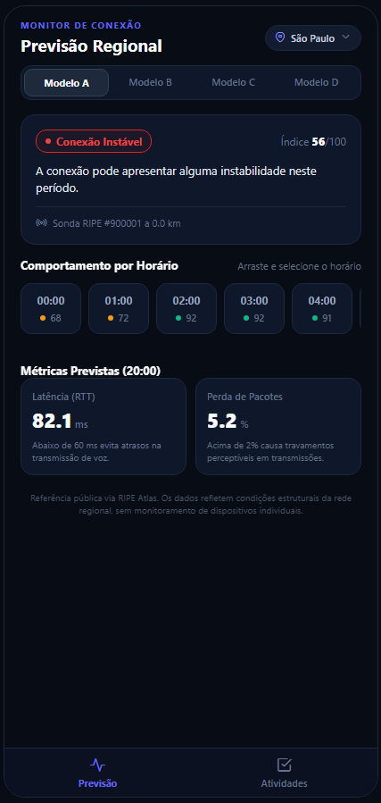
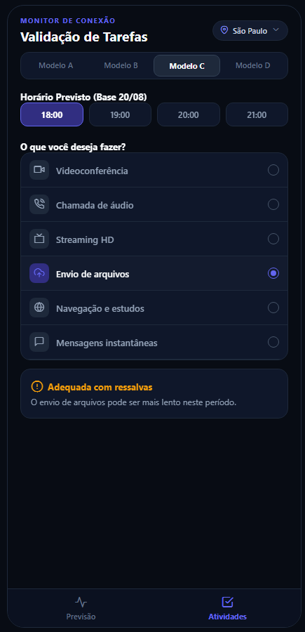

# 🌐 Monitor de Conexão — Previsão de Qualidade de Rede

*Projeto Interdisciplinar — Centro Universitário Braz Cubas — Semestre 2026/2*  
*Integração Curricular:* Programação para Dispositivos Móveis • Análise e Projeto de Sistemas II • Redes de Computadores  
*Docentes Responsáveis:* Profa. Aline dos Santos, Prof. Davi de Oliveira Cruz e Profa. Denise Braito  

---

## 📌 Visão Geral do Produto

O **Monitor de Conexão** é uma solução móvel desenvolvida para mitigar o impacto da instabilidade de rede para estudantes e profissionais em regime de teletrabalho. O sistema cruza dados históricos de telemetria pública com modelos preditivos de inteligência artificial para antecipar períodos de degradação da conexão, traduzindo métricas técnicas complexas em diretrizes práticas e acessíveis.

O projeto está fundamentado no **ODS 9 (Indústria, Inovação e Infraestrutura)** da ONU, promovendo a inclusão digital e reduzindo a assimetria técnica por meio de uma interface desenhada sob os preceitos de baixa carga cognitiva, sem coleta de dados privados e acessível para usuários não especialistas.

---

## 📡 Fundamentos de Redes de Computadores & Telemetria

O sistema apoia-se em conceitos estruturais da arquitetura de redes para transformar medições brutas em recomendações contextualizadas:

* **Auditoria de Sistemas Autônomos (RIPE Atlas & ASNs):** As previsões utilizam como referência geográfica sondas públicas instaladas em Sistemas Autônomos (ASNs) estratégicos no Brasil. Isso permite monitorar a integridade dos pontos de troca de tráfego (IXPs) e do trânsito IP regional, desacoplando a infraestrutura pública de eventuais oscilações pontuais do enlace local (Wi-Fi).
* **Métricas Ativas de Qualidade de Serviço (QoS):**
  * **RTT (Round Trip Time / Latência):** Monitora o atraso de propagação e enfileiramento dos pacotes (em milissegundos). Valores abaixo de 60 ms oferecem experiência contínua sem atrasos em chamadas.
  * **Packet Loss (Perda de Pacotes):** Avalia a taxa de descarte provocada por congestionamento em buffers de roteadores. Valores superiores a 2% degradam substancialmente serviços síncronos.
  * **Jitter (Variação do Atraso):** Oscilações na chegada dos pacotes que provocam dessincronização em transmissões de áudio e vídeo em tempo real.
* **Tolerância por Protocolo da Camada de Transporte:**
  * **Tráfego em Tempo Real (UDP / RTP):** Aplicado a chamadas de vídeo e voz. Por não utilizar mecanismos de retransmissão, exige latência estrita e descarte mínimo para evitar congelamento de mídia.
  * **Tráfego Confiável com Controle de Fluxo (TCP):** Aplicado a navegação e streaming de mídia. Buffers locais toleram latência moderada, mas a perda de pacotes força janelas de congestionamento reduzidas, diminuindo a taxa de transferência.
* **Transição de QoS para QoE:** O sistema converte indicadores técnicos de rede (QoS) em Qualidade de Experiência (QoE) para o usuário comum, informando objetivamente se a conexão é adequada para reuniões, estudos ou envio de arquivos.

---

## 📱 Funcionalidades da Interface Mobile (React Native)

O aplicativo organiza a experiência em abas inferiores nativas (*Bottom Navigation Bar*), focadas em acessibilidade (WCAG 2.2 Nível AA) e modo escuro de alto contraste:

### 1. Aba Previsão (P01)
* **Diagnóstico Consolidado:** Apresentação clara do status da rede (Boa, Regular ou Instável) acompanhado de pontuação de 0 a 100 e recomendação contextual.
* **Régua Temporal 24h (Timeline Strip):** Carrossel horizontal deslizante com as previsões hora a hora de todo o dia, recalculando as métricas instantaneamente ao toque.
* **Telemetria Explicada:** Cards dedicados para RTT médio (latência) e taxa de descarte de pacotes (%), com textos de apoio em linguagem simples.
* **Seletor de Regiões:** Alternância entre GPS automático e sondas estratégicas registradas (São Paulo, Rio de Janeiro e Manaus).

### 2. Aba Atividades (P03)
* **Validação por Horário:** Simulação da estabilidade em faixas horárias selecionadas da base de testes.
* **As 6 Atividades da Especificação:** Videoconferência, chamada de áudio, streaming HD, envio de arquivos, navegação e mensagens instantâneas.
* **Classificação Semântica em 3 Estados:** Diagnóstico entre **Adequada**, **Adequada com ressalvas** e **Não recomendada**, orientando com clareza o comportamento da rede em tarefas críticas.

  ## 📸 Demonstração da Interface

<div align="center">
  
  &nbsp;&nbsp;&nbsp;&nbsp;
  
</div>

---

## 🔌 Contratos da API & Status de Integração

O aplicativo móvel conecta-se em produção à **Internet Quality API** oficial hospedada no Render: `https://internet-quality-api.onrender.com/api/v1`.

| Método | Endpoint | Finalidade | Status no App Mobile |
| :--- | :--- | :--- | :---: |
| **GET** | `/api/v1/models` | Consulta dos modelos preditivos ativos (A, B, C e D) | **Consumido** |
| **GET** | `/api/v1/forecasts/nearby` | Previsão pela sonda mais próxima via geolocalização | **Consumido** |
| **GET** | `/api/v1/forecasts/probes/{id}/timeline` | Projeção temporal horária da sonda ao longo de 24h | **Consumido** |
| **POST** | `/api/v1/activity/check` | Validação de viabilidade para tarefas e horários específicos | **Consumido** |
| **GET** | `/api/v1/health` | Diagnóstico de integridade do servidor em nuvem | **Consumido** |
| **GET** | `/api/v1/locations` | Listagem das sondas públicas cadastradas | **Mapeado / Suportado** |

---

## ♿ Acessibilidade e Experiência do Usuário (RNF01 a RNF09)

* **Tradução Contextual:** Eliminação de barreiras cognitivas pela substituição de jargões técnicos por termos autoexplicativos:
  * *Latência / RTT* → *Tempo de Resposta (Atraso)*
  * *Packet Loss* → *Perda de Pacotes / Falha de Dados*
  * *Quality Score* → *Índice Geral da Conexão (0 a 100)*
* **Independência de Cor:** Todos os estados da rede e vereditos de atividades associam rótulos textuais explícitos a ícones semânticos distintos (sem depender unicamente do verde/vermelho).
* **Resiliência e Recuperação de Falhas:** Tratamento de latência e cold-starts da nuvem por meio de telas de estado amigáveis e botão de nova tentativa (*retry*).
* **Transparência e Privacidade:** Exibição do aviso legal obrigatório, pontuando que as estimativas decorrem de sondas públicas regionais, sem medição invasiva no dispositivo do usuário.

---

## 📁 Estrutura do Monorepo

```text
app-monitor-conexao/
├── frontend/               # Aplicativo móvel (React Native / Expo)
│   ├── assets/             # Recursos visuais e ícones
│   ├── src/
│   │   └── services/       # Camada de comunicação REST (forecastService.js)
│   ├── App.js              # Camada de interface com abas, timeline e acessibilidade
│   ├── app.json            # Manifesto e metadados do Expo
│   └── package.json        # Dependências Node.js e scripts
│
├── backend/                # API RESTful de APS II (Java 17 / Spring Boot 3)
│   ├── data/               # Séries temporais históricas (predictions.csv e models.json)
│   ├── src/                # Controladores, regras de negócio e repositórios
│   └── pom.xml             # Manifesto Maven e testes com cobertura JaCoCo
│
├── .gitignore              # Regras de exclusão de logs e temporários
└── README.md               # Documentação técnica unificada
```

---

## 🛠️ Tecnologias Utilizadas

### Frontend (Mobile)
* **Framework:** React Native com ecossistema Expo
* **Linguagem:** JavaScript (ES6+)
* **Ícones & Estilização:** Feather Icons (`@expo/vector-icons`), design escuro fosco de alto contraste
* **Geolocalização:** `expo-location` (com coordenadas de contingência)
* **Persistência Local:** `@react-native-async-storage/async-storage` (armazena o modelo preditivo selecionado)

### Backend (Produção & APS II)
* **Nuvem (Mobile):** FastAPI / Python hospedada no Render (Internet Quality API)
* **Retaguarda Complementar (APS II):** Java 17 com Spring Boot 3.4.0, JUnit 5 e relatórios de cobertura JaCoCo

---

## 🚀 Como Executar o Projeto

### 1. Aplicativo Móvel (Avaliação Principal - Mobile)
Graças à integração com a API em nuvem, não é necessário compilar nem rodar nenhum servidor backend local para testar o aplicativo móvel.

1. Acesse a pasta do frontend e instale as dependências:
   ```bash
   cd frontend
   npm install
   ```

2. Inicie o servidor Metro com limpeza de cache:
   ```bash
   npx expo start -c
   ```

3. **Para testar:**
   * **No Navegador:** Pressione a tecla `w` no terminal para abrir no navegador.
   * **No Celular:** Abra o aplicativo **Expo Go** e escaneie o QR Code exibido no terminal.

### 2. Backend Java (Opcional - APS II)
Para executar a API alternativa desenvolvida para a disciplina de APS II:
```bash
cd backend
mvn spring-boot:run
```
O servidor local iniciará na porta `8080`, com documentação Swagger disponível em `http://localhost:8080/swagger-ui.html`.

---

## 👥 Integrantes da Squad (Grupo 9)

* **Vinicius Matheus da Silva Rocha** — RGM: 43073328  
* **Matheus Hideki Beltran Iqueoka** — RGM: 43347444  
* **Nara Cauany Ariette de Godoy** — RGM: 40450902  
* **Ana Clara de Oliveira Gimenes** — RGM: 43577725
